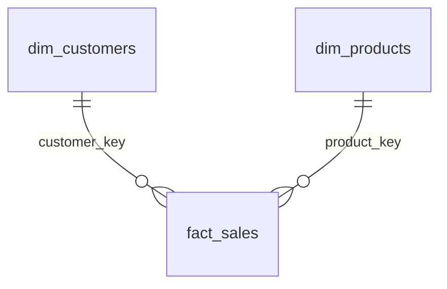

# Catálogo de datos – Capa Gold

La capa Gold es la que consumen el negocio y los analistas. Usa un **esquema estrella**: una tabla de hechos (`fact_sales`) rodeada de dimensiones (`dim_customers`, `dim_products`). Integra la información de CRM y ERP y solo contiene el conjunto de datos más reciente (sin historial).

## Modelo de datos

Fórmula de negocio: `sales_amount = quantity * price`

## Flujo de datos

| Origen (CSV)            | Bronze / Silver            | Gold             |
|-------------------------|----------------------------|------------------|
| CRM `cust_info`         | `crm_cust_info`            | `dim_customers`  |
| ERP `CUST_AZ12`         | `erp_cust_az12`            | `dim_customers`  |
| ERP `LOC_A101`          | `erp_loc_a101`             | `dim_customers`  |
| CRM `prd_info`          | `crm_prd_info`             | `dim_products`   |
| ERP `PX_CAT_G1V2`       | `erp_px_cat_g1v2`          | `dim_products`   |
| CRM `sales_details`     | `crm_sales_details`        | `fact_sales`     |

---

## gold.dim_customers
Un registro por cliente, con datos demográficos y geográficos.

| Columna          | Tipo         | Descripción                                                    |
|------------------|--------------|----------------------------------------------------------------|
| customer_key     | INT          | Clave subrogada del cliente.                                   |
| customer_id      | INT          | Identificador numérico del cliente en el CRM.                  |
| customer_number  | VARCHAR(50) | Código del cliente (ej. `AW00011000`).                         |
| first_name       | VARCHAR(50) | Nombre.                                                        |
| last_name        | VARCHAR(50) | Apellido.                                                      |
| country          | VARCHAR(50) | País de residencia (ej. `Australia`); `n/a` si no se conoce.   |
| marital_status   | VARCHAR(50) | `Married`, `Single` o `n/a`.                                   |
| gender           | VARCHAR(50) | `Male`, `Female` o `n/a` (CRM primero, ERP como respaldo).     |
| birthdate        | DATE         | Fecha de nacimiento (ERP).                                     |
| create_date      | DATE         | Fecha en que se creó el cliente en el CRM.                     |

## gold.dim_products
Un registro por producto vigente, con su categoría.

| Columna          | Tipo         | Descripción                                                    |
|------------------|--------------|----------------------------------------------------------------|
| product_key      | INT          | Clave subrogada del producto.                                  |
| product_id       | INT          | Identificador del producto en el CRM.                          |
| product_number   | VARCHAR(50) | Código del producto (ej. `BK-R93R-62`).                        |
| product_name     | VARCHAR(50) | Nombre descriptivo.                                            |
| category_id      | VARCHAR(50) | Código de categoría (ej. `BI_RB`).                             |
| category         | VARCHAR(50) | Categoría (ej. `Bikes`, `Components`).                         |
| subcategory      | VARCHAR(50) | Subcategoría (ej. `Road Bikes`).                               |
| maintenance      | VARCHAR(50) | `Yes` / `No`: si el producto requiere mantenimiento.           |
| cost             | INT          | Costo base del producto.                                       |
| product_line     | VARCHAR(50) | `Road`, `Mountain`, `Touring`, `Other Sales` o `n/a`.          |
| start_date       | DATE         | Fecha desde la que el producto está disponible.                |

## gold.fact_sales
Un registro por línea de pedido de venta.

| Columna          | Tipo         | Descripción                                                    |
|------------------|--------------|----------------------------------------------------------------|
| order_number     | VARCHAR(50) | Número de pedido (ej. `SO54496`).                              |
| product_key      | INT          | Referencia a `dim_products`.                                   |
| customer_key     | INT          | Referencia a `dim_customers`.                                  |
| order_date       | DATE         | Fecha del pedido.                                              |
| shipping_date    | DATE         | Fecha de envío.                                                |
| due_date         | DATE         | Fecha de vencimiento del pago.                                 |
| sales_amount     | INT          | Monto total de la línea (`quantity * price`).                  |
| quantity         | INT          | Unidades vendidas.                                             |
| price            | INT          | Precio unitario.                                               |
